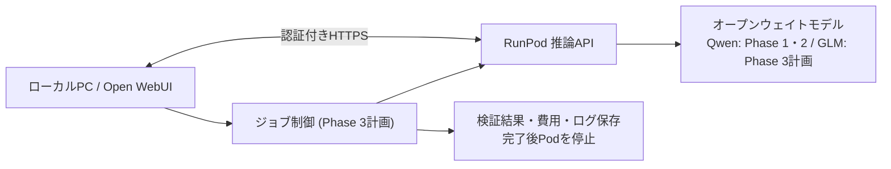

# Open LLM Multimodal Lab

[English](README.md) | [日本語](README.ja.md)

**オープンウェイトLLMをGPU上で動かし、マルチモーダル処理・コードレビュー・防御的セキュリティ分析を比較する実験プロジェクトです。** Qwenのチャット・画像理解アプリから始まり、RunPodを使ったGLMなど複数モデルの比較検証へ対象を広げています。商用運用済みのサービスではなく、設計と実測を積み上げる研究用リポジトリです。

## どこまでできた？

| Phase | 目標 | 実施した内容 | 状態 |
| --- | --- | --- | --- |
| **1：GPU接続** | RunPodの推論APIとローカルOpen WebUIを接続 | **2026-10-09** にRTX PRO 4000（24GB）上のQwen2.5-1.5B-Instructから、認証付きHTTPS経由で `Connected successfully.` を受信。検証後Podを削除。 | **最小構成で実証済み** [検証記録](docs/runpod-phase1-verification-2026-10-09.md) |
| **2：大型Qwen** | **A100 80GB** でQwen 27B級を起動し、マルチモーダル化 | **2026-10-15** にRunPodのA100 SXM 80GB上の `Qwen/Qwen3.8-27B`（BF16、vLLM）へOpen WebUIから認証付きHTTPSで1回質問し、指示どおりの回答を受信（875秒・約$0.44）。検証後Podを削除。Colab/Gradioによる会話・画像理解・画像生成/編集アプリも整備済み。 | **1回答の接続試験で実証済み** [検証記録](docs/runpod-phase2-verification-2026-10-15.ja.md)。品質・速度、manual-hook経路、Q8_K_LのVRAM・速度計測は未確認 |
| **3：モデル比較** | GLMのOriginal / Uncensored / Security-specificを同一課題で比較 | 設計を整理。**2026-10-15** にモデル台帳（revision固定）・llama.cppイメージの対応確認・評価セットと隔離採点器（模擬サーバーで検証）を準備。H200 SXMでのAは**重みのダウンロード速度で中止**（約23分・約$2.04、出力0件）。Bは未実施、Cは費用試算のみ。 | **準備完了・モデル結果はまだなし** [試行記録](docs/phase3-trial-2026-10-15.ja.md) / [日本語設計](docs/phase3-glm-evaluation.ja.md) |

## システム概要

**現在できること：** Qwenによる対話・画像理解、画像生成/編集、Web検索、GitHubの読み取り専用調査、PDF/短い動画の解析、音声入力・読み上げ。これらは既存の`src/qmc/`とGradioを使う機能です。Phase 1の最小接続テストと、今後のPhase 3ジョブ実行は別の構成です。

### Phase 3で比較するモデル

| 系列 | モデル | 検証内容 |
| --- | --- | --- |
| Original | [公式 GLM-5.3-Flash](https://huggingface.co/zai-org/GLM-5.3-Flash) | ベースラインの精度・速度・コスト |
| Uncensored | [Huihui GLM-5.3-Flash Abliterated GGUF](https://huggingface.co/huihui-ai/Huihui-GLM-5.3-Flash-abliterated-GGUF) | 拒否率・実用精度への影響 |
| Security-specific | [dealignai GLM-5.3-CYBERSECURITY-FP8](https://huggingface.co/dealignai/GLM-5.3-CYBERSECURITY-FP8) | 脆弱性発見・誤検知・費用。**フルGLM-5.3でありFlashとは規模が異なる** |

認証付きジョブAPIでタスクを投入し、結果を保存してからPodを停止します。**最大3時間は停止上限**で、常時稼働も3時間の固定稼働も意図しません。詳細：[Phase 3 全体・詳細設計](docs/phase3-glm-evaluation.ja.md)。

## 試してみる

- [Qwenチャット専用Colab](Qwen-Q8-Chat-Colab.ipynb)：A100 80GBを想定。画像生成なし。
- [QwenマルチモーダルColab](https://colab.research.google.com/github/moruku36/open-llm-multimodal-lab/blob/main/Qwen-Multimodal-Colab.ipynb)：必要に応じてColab Secretsに`HF_TOKEN`と検索APIキーを追加し、セル1〜4を順番に実行。
- GPU不要のモックUI：`pip install -r requirements-dev.txt` の後、`PYTHONPATH=src python -m qmc --mock`。モック成功はGPU実機の成功を意味しません。

既存のQwen専用コード名、Google Drive保存先（`qwen-multimodal-colab`）と`src/qmc/`は互換性のため維持。RunPodライフサイクル管理は別の [qwen-runpod-operations](https://github.com/moruku36/qwen-runpod-operations) を参照してください。

## 技術ドキュメント

| 内容 | リンク |
| --- | --- |
| Phase 1接続検証 | [2026-10-09の記録](docs/runpod-phase1-verification-2026-10-09.md) |
| Phase 2 Qwen3.8-27B接続検証・反省点・Phase 3への注意点 | [日本語](docs/runpod-phase2-verification-2026-10-15.ja.md) / [English](docs/runpod-phase2-verification-2026-10-15.md) |
| Phase 2 Q8計画・VRAM計測 | [ロードマップ](docs/chat-only-roadmap.md) / [測定記録](docs/vram-measurements.md) |
| Phase 3全体・詳細設計 | [日本語](docs/phase3-glm-evaluation.ja.md) / [English](docs/phase3-glm-evaluation.md) |
| Phase 3試行記録（2026-10-15）・評価セット | [日本語](docs/phase3-trial-2026-10-15.ja.md) / [English](docs/phase3-trial-2026-10-15.md) / [evaluation/phase3](evaluation/phase3/) |
| 既存アプリの構成・実装・使い方 | [アーキテクチャ](docs/architecture.md) / [技術ガイド](TECHNICAL.md) |

**制約：** PDFは最初の6ページ・30MB、動画は30秒・最大8フレーム。OSSの調査エージェントは読み取り専用。GPU要件・ホストRAM・料金はモデルと量子化形式で異なります。生成したコードは適用前に人手で確認してください。ソースコードはMIT、モデルの重みは各モデル固有のライセンスに従います。

更新日：2026-10-15
