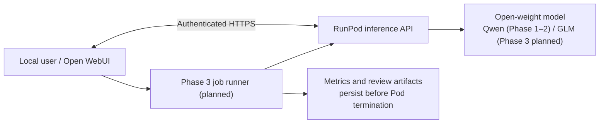

# Open LLM Multimodal Lab

[English](README.md) | [日本語](README.ja.md)

**An experimental lab for running, connecting, and comparing open-weight AI models** across multimodal tasks, code review, and defensive security evaluation. Started as a Qwen-based Gradio app; now expanding to GLM and other models with on-demand RunPod inference. **This is a research project, not a production-ready hosted service.**

## Progress at a glance

| Phase | Goal | What was achieved | Status / evidence |
| --- | --- | --- | --- |
| **1 — Connectivity** | Connect a remote GPU model to Open WebUI | On **2026-10-09**, a Qwen2.5-1.5B-Instruct model on a RunPod RTX PRO 4000 (24GB) returned `Connected successfully.` through authenticated HTTPS; the test Pod was deleted afterwards. | **Verified minimal smoke test** — [record](docs/runpod-phase1-verification-2026-10-09.md) |
| **2 — Larger Qwen model** | Run a 27B-class Qwen model on **A100 80GB**, advance multimodal functionality | The maintainer reports that the target Qwen 27B model ran on A100 80GB. The existing Colab/Gradio app supports chat, vision, image generation/editing and several supporting tools. | **Model launch reported; integrated workflow and Q8/VRAM benchmark still need documented GPU evidence.** |
| **3 — Cross-model benchmarking** | Evaluate GLM Original, Uncensored and Security-specific variants with single-job RunPod execution | Architecture, model candidates, evaluation criteria and cost controls documented in English and Japanese. | **Designed only — no Phase 3 implementation or GPU runs yet.** [Design EN](docs/phase3-glm-evaluation.md) / [JA](docs/phase3-glm-evaluation.ja.md) |

## System overview

**What exists today:** Qwen chat/vision through `llama.cpp`, Qwen-Image via `diffusers`, Gradio UI, web search, read-only GitHub research, PDF/short-video understanding, speech input and optional speech output. See [technical guide](TECHNICAL.md) and [architecture](docs/architecture.md). This application is distinct from the Phase 1 minimal RunPod demonstration and the planned Phase 3 orchestrator.

**What Phase 3 will test:** official [GLM-5.3-Flash](https://huggingface.co/zai-org/GLM-5.3-Flash), [Huihui abliterated Flash GGUF](https://huggingface.co/huihui-ai/Huihui-GLM-5.3-Flash-abliterated-GGUF), and [dealignai GLM-5.3 cybersecurity FP8](https://huggingface.co/dealignai/GLM-5.3-CYBERSECURITY-FP8). The cybersecurity variant is based on full GLM-5.3, not Flash; comparisons must distinguish model scale, quantization, and safety tuning. The future job API will store output before stopping the Pod, with a **3-hour maximum runtime**, not a fixed billing session.

## Try the existing Qwen application

- [Chat-only Colab notebook](Qwen-Q8-Chat-Colab.ipynb) — A100 80GB target, no image generation.
- [Full multimodal Colab notebook](https://colab.research.google.com/github/moruku36/open-llm-multimodal-lab/blob/main/Qwen-Multimodal-Colab.ipynb) — chat/vision and image workflow; requires an A100-class runtime. Set `HF_TOKEN` and optional web-search keys in Colab Secrets; run cells 1–4.
- Local mock UI (no GPU): `pip install -r requirements-dev.txt`, then `PYTHONPATH=src python -m qmc --mock`. Mock tests are not proof of GPU compatibility.

The existing app and its `src/qmc/` package keep their Qwen-specific names for backward compatibility. [RunPod operations](https://github.com/moruku36/qwen-runpod-operations) are managed separately.

## Documentation

| Topic | Link |
| --- | --- |
| Phase 1 connection evidence | [Trial report](docs/runpod-phase1-verification-2026-10-09.md) |
| Phase 2 Q8 plan and measurement limitations | [Q8 roadmap](docs/chat-only-roadmap.md), [VRAM evidence](docs/vram-measurements.md) |
| Phase 3 overall + detailed design | [English](docs/phase3-glm-evaluation.md), [日本語](docs/phase3-glm-evaluation.ja.md) |
| Existing application's architecture and operations | [Architecture](docs/architecture.md), [Technical guide](TECHNICAL.md), [Japanese guide](README.ja.md) |

### Limitations and responsibilities
GPU costs, system RAM, weight storage, and download time vary substantially with model format and RunPod instance. Do not treat a successful model load as a completed benchmark. PDF input is limited to the first six pages (30MB); videos to 30 seconds / 8 frames. GitHub exploration is read-only. Protect access credentials and review generated code before applying it. Source code is MIT-licensed; **model weights carry their own licenses**.

Updated: 2026-10-13.
