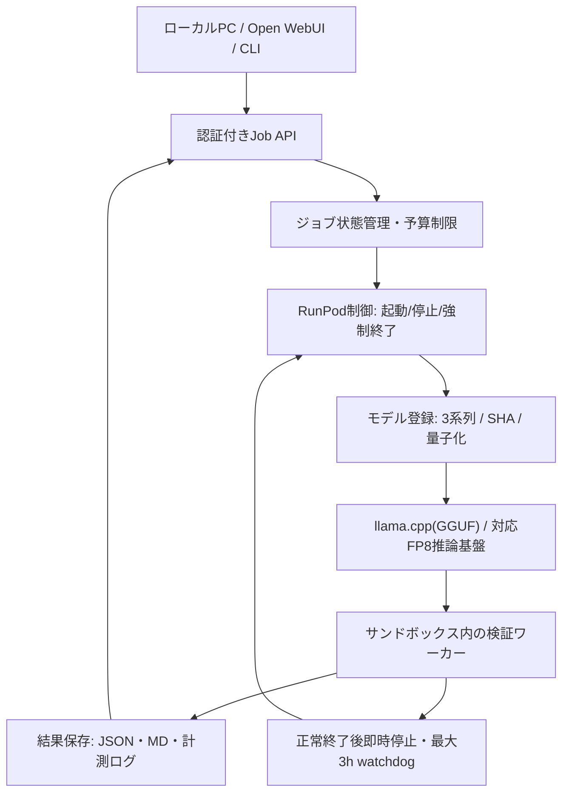

# Phase 3：GLM 3系列の比較評価 — 全体設計・詳細設計（2026-10-13）

> **現在の状況（2026-10-15）：** オーナーは**RunPod検証を終了**しました。再開の予定も新たな承認もありません。P3-0（準備）は完了、Aは試行したがモデルの重みのダウンロード途中で中止、Bは未実施、Cは費用試算のみです。**モデルの推論出力・ベンチマーク結果はありません**（模擬採点の数値はテスト用フィクスチャでGLMの実測ではありません）。以下は**2026-10-13時点の過去の設計提案**で、日付付きの現在の状況通知を添えた過去の設計参照として保持しています。[試行記録](phase3-trial-2026-10-15.ja.md)・[最終振り返り](runpod-retrospective-2026-10-15.ja.md)を参照。

2026-10-13時点のステータス：**設計のみ。未実装・GPU未検証。** 表示用の名称は **Open LLM Multimodal Lab**。リポジトリ名はその後 `open-llm-multimodal-lab` に変更済みです。

[English](phase3-glm-evaluation.md)

## 目的・既存Phaseとの関係
Phase 1：Open WebUIへの最小接続が検証済み（接続確認のみで、モデル品質の比較ではない）。Phase 2（2026-10-15）：A100 SXM 80GBでQwen3.8-27B（BF16、vLLM）をOpen WebUIのOpenAI互換HTTPS経由で呼び出し、1回答を確認した（[Phase 2報告](runpod-phase2-verification-2026-10-15.ja.md)）。ただしmanual-hook経路・Q8_K_L・VRAM・速度・品質・長文脈・マルチモーダルのベンチマークは未確認で、既存ドキュメントの統合ワークフローとは同一視しない。Phase 3：Qwen専用の既存実装を壊さず、任意のオープンウェイトLLMをジョブ単位でRunPodへロードし、レビュー結果保存後ただちに停止する。最大3時間は停止上限であり3時間稼働する必要はない。

## 採用する3系列
| 系列 | モデル | 選定理由 | 比較上の注意 |
|---|---|---|---|
| A Original | [zai-org/GLM-5.3-Flash](https://huggingface.co/zai-org/GLM-5.3-Flash) | 公式ベースライン。実行可能な公式重み・GGUF変換を検証 | Bと可能な限り同等ビット精度を使用 |
| B Uncensored | [huihui-ai/Huihui-GLM-5.3-Flash-abliterated-GGUF](https://huggingface.co/huihui-ai/Huihui-GLM-5.3-Flash-abliterated-GGUF) | GGUFが入手でき、同系列コミュニティの活動が活発 | 解除の程度と品質維持は未実証 |
| C Security-specific | [dealignai/GLM-5.3-CYBERSECURITY-FP8](https://huggingface.co/dealignai/GLM-5.3-CYBERSECURITY-FP8) | セキュリティ特化派生を別枠評価 | **フルGLM-5.3 753B**でありFlash 321Bではない。単純な同条件比較は不可 |

2026-10-13時点でHuihuiのFlash GGUFはHugging Face上約2.9万ダウンロード／238いいねを確認。dealignaiのFlash FP8とは公開形式・経過日数が違い、厳密なユーザー数ランキングではない。初期実行適性も含めBをHuihuiと決定した。Cについて低ビット版が存在すると断定しない。

## 概要構成

Pod管理・資格情報は既存の [qwen-runpod-operations](https://github.com/moruku36/qwen-runpod-operations) と連携する設計。実装済みと誤認しない。同期で3時間待つAPIではなく、`POST /v1/jobs`→202＋job_id→`GET /v1/jobs/{id}`→`GET /v1/jobs/{id}/results` とする。

## 詳細：状態遷移・失敗処理
`QUEUED → PROVISIONING → DOWNLOADING → LOADING → RUNNING → UPLOADING → COMPLETED → TERMINATED`。途中のエラーでは `FAILED/TIMED_OUT → TERMINATED`。結果を永続ストレージに保存し完全性を確認してからPod停止。例外経路のfinallyに加え独立watchdogで強制終了、孤児Podを防止。再試行は冪等キーで重複作成を回避。認証・入力検証・ログの秘密情報マスクを必須とする。

## 詳細：メモリとGPU選定
- MoEのactive parameter数はGPUに置く総重みサイズではない。量子化ファイル実容量、KV cache、ワークスペース、CPU RAM、ディスクをすべて見積もる。
- A/Bを先行：GGUF＋llama.cpp、可能な限り同等の量子化設定。A100 80GB ×1 ＋CPU offloadで起動可能か事前確認。4kコンテキスト、同時実行1で開始し8kへ拡張。
- 低bit GGUF、CPU Expert/Layer Offloading、KV量子化、GPUレイヤ調整の各効果を別々に記録。速度が不足する場合はH200×2等の大容量GPUへ。Tensor parallel／推論バックエンド対応を個別に検証。
- CはFP8モデル配布容量だけで約756GB。H200複数枚（例：8台）の候補はあり得るが、実行保証はない。**費用を明示し、上限予算を承認してから**実機確保。
- NVFP4／GGUF量子化／CPU offload／Tensor Parallel／KV Cache Quantization／FlashAttentionは異なる最適化。量子化それ自体でガードレールが除去されるわけではない。
- モデル取得時はHugging Face revisionを固定しチェックサム、ライセンス、custom-code可否を記録。未知コードを自動実行しない。

## 詳細：比較テスト
同一のOSSコミット・問題セット・プロンプト・出力制限・乱数seed・温度でA/Bを比較。Cはフルモデルのため参考比較枠。
1. 既知不具合を含む小型OSSのバグ原因分析と修正案、テスト通過率
2. 自分が管理する脆弱性検証用コードに埋め込んだ既知問題の検出、証拠ファイル／行番号
3. 静的レビューのprecision / recall / false positive
4. 無害・境界事例に対する拒否率と、推論品質の劣化有無
5. 画像＋テキスト入力の理解（モデル／projector／推論エンジンが対応する場合のみ）
攻撃実行や外部サービスへの無許可診断を行わない。生成パッチは人手レビュー後に適用する。

### 共通成果物
`report.json`: track、HF repo・固定SHA、量子化、API設定、入力ケース、検出結果・根拠・判定。
`metrics.json`: GPU型番・枚数・VRAM、ホストRAM、ディスク、入力/出力tokens、prefill/decode tokens/s、p50/p95、ロード時間、GPU課金額、保存費用、**成功ジョブ当たりコスト**。
`report.md`: 比較結果、誤検知、失敗事由、再現手順。秘密情報は保存しない。

## 受け入れ条件と作業順
- P3-0 レジストリ・モデル互換性／ライセンス・予算・サンプルセットの準備
- P3-A OriginalのGGUF起動・API疎通・1ジョブ完了
- P3-B Huihuiを同じテストで実施し拒否率／品質／費用差を数値化
- P3-C dealignai Cybersecurity-FP8の実行可否・GPU費用確認、予算内のみ実行
- P3-report 実測ログ・結果を日英で公開。**テストが成立しない場合も、失敗原因と費用を記録**
- 各段階で最大10800秒の停止上限、ジョブ完了即終了、不要Podゼロ、秘密情報の混入ゼロ
- 成功の定義はモデルのロードのみでなく「証拠付きの1ジョブ完了」。Cは予算超過・実行困難の記録も有効な結論。

### 未完了（最終状況、2026-10-15）
Phase 3のジョブAPI・オーケストレーターは未実装で、ベンチマークは未実施。P3-0は完了、AはGPU Podで試行したがモデルの重みのダウンロード完了前に中止、Bは未実施、Cは費用試算のみ。評価は終了し、ベンチマーク結果はなく、再開予定もありません。リポジトリ名の変更は完了済み（`open-llm-multimodal-lab`）。本書は過去の設計提案であり、計画ではありません。
