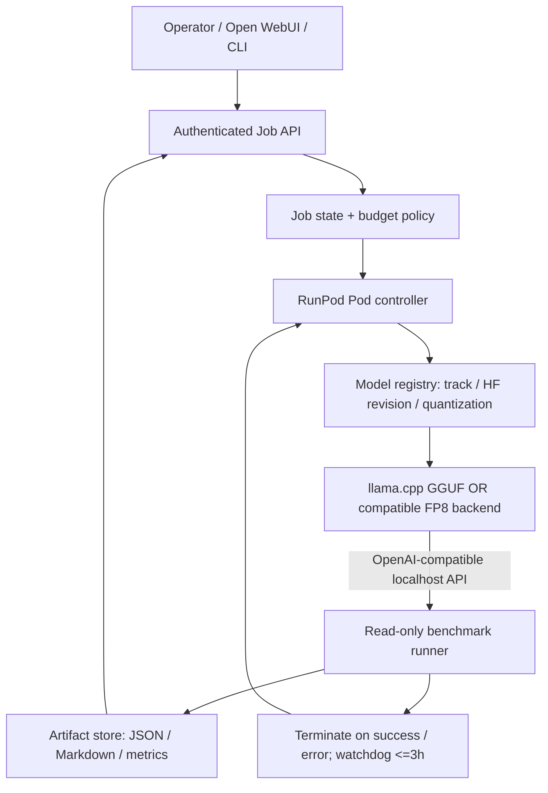

# Phase 3 — Open LLM model-variant evaluation (2026-10-13)

> **CURRENT STATUS (2026-10-15):** The owner has **ended the RunPod evaluation**; no restart is planned or newly authorized. P3-0 preparation is done; track A was attempted and aborted during the model-weights download; B was not run; C was cost-estimated only. There are **no model inference outputs or benchmark results** (mock-scorer numbers are test fixtures, not GLM measurements). Everything below is the **historical 2026-10-13 design proposal**, retained as a historical design reference with current dated status notices. See the [trial record](phase3-trial-2026-10-15.md) and [final retrospective](runpod-retrospective-2026-10-15.md).

Historical status at 2026-10-13: **DESIGN ONLY — not implemented or GPU-verified.** This phase extends the existing Qwen multimodal experiments; it does not replace the existing application. Project display name: **Open LLM Multimodal Lab**; the repository has since been renamed to `open-llm-multimodal-lab`.

[日本語](phase3-glm-evaluation.ja.md)

## Goal and scope
On-demand, single-job RunPod inference comparing (A) the official original, (B) an abliterated/uncensored derivative, and (C) a cybersecurity-specialized derivative. A job is submitted over authenticated HTTPS, processed once, results are persisted, and the Pod is terminated no later than 3 hours after start. Never claim a successful GPU run without logs, model revision, benchmark output, and an explicit completion record.

## Selected candidates (pin immutable revisions before running)
| Track | Hugging Face model | Rationale | Fairness caveat |
|---|---|---|---|
| A — Original | [zai-org/GLM-5.3-Flash](https://huggingface.co/zai-org/GLM-5.3-Flash); suitable original GGUF subject to format verification | official baseline | quantize as closely as practical to B |
| B — Uncensored | [huihui-ai/Huihui-GLM-5.3-Flash-abliterated-GGUF](https://huggingface.co/huihui-ai/Huihui-GLM-5.3-Flash-abliterated-GGUF) | accessible GGUF and substantial community activity | abliterated is not automatically more accurate or fully unrestricted |
| C — Security-specific | [dealignai/GLM-5.3-CYBERSECURITY-FP8](https://huggingface.co/dealignai/GLM-5.3-CYBERSECURITY-FP8) | cybersecurity-targeted derivative | **753B full GLM-5.3**, not the 321B Flash baseline; not an isolated fine-tune comparison |

Choice B versus dealignai's Flash uncensored variant was made using publicly visible HF engagement and practical A100 compatibility as of 2026-10-13, not verified active-user counts. Huihui's Flash GGUF showed ~29k downloads and ~238 likes at inspection; different formats/release ages prevent strict usage rankings. Track C has no guaranteed available low-bit checkpoint: do not substitute an unrelated GGUF while reporting it as that checkpoint.

## Architecture

The orchestration/API design belongs here; actual Pod lifecycle and credentials remain managed by [qwen-runpod-operations](https://github.com/moruku36/qwen-runpod-operations). No public unauthenticated model endpoint. Prefer a job POST and polling GET to a long-lived synchronous connection. States: QUEUED → PROVISIONING → DOWNLOADING → LOADING → RUNNING → UPLOADING → COMPLETED/FAILED/TIMED_OUT → TERMINATED. Termination is attempted in a finally path and a separate watchdog; persistence precedes termination.

## Model-fit gates and fallback
1. Resolve HF exact revision and actual shard size before provisioning; check license, safety claims, tokenizer/template, multimodal attachments and backend compatibility.
2. Preflight `required_host_ram >= actual_model_file_size - effective_GPU_offload + runtime_margin`; confirm CPU RAM as well as GPU VRAM, ephemeral disk and persistent cache capacity. MoE active parameters do **not** imply the remaining expert weights need no memory.
3. For A/B first test GGUF with llama.cpp + lowest acceptable quantization; A100 80GB ×1 + CPU expert/layer offload **only if** host RAM fits. Context 4k → 8k, concurrency 1, lower KV-cache precision where supported.
4. If OOM, loading failure, or throughput is insufficient for one complete benchmark in the 3h envelope, evaluate 2× H200 or other supported large-memory GPUs; test compatible tensor parallelism. Stop if budget would be exceeded.
5. Track C: FP8 approximately 756GB of stored weights alone; a multi-GPU H200-class configuration (such as 8×H200 if supported) is a **candidate**, not a verified recipe. Require explicit cost approval before allocating expensive multi-GPU hardware.
6. NVFP4, dynamic GGUF quantization, expert offload, KV quantization, tensor parallel, FlashAttention and speculative decoding are independent options. Test one change at a time and document compatibility. Do not treat quantization as removal of guardrails.
7. Use an **immutable checkpoint revision** and SHA256 for reproducibility. Do not run arbitrary model-repository custom code without review.

## API contract (proposed)
`POST /v1/jobs` request: `{job_id, track, checkpoint_revision, task_pack, max_usd, max_runtime_seconds:10800, context_tokens, seed}`. The server sets a UUID if absent. Return `202 {job_id,status_url}`; `GET /v1/jobs/{id}` returns state and artifact URLs; `GET /v1/jobs/{id}/results` returns versioned `report.json`, `report.md`, `metrics.json`. Authentication required, schema validation, idempotency key, per-job isolation, redacted logs and no arbitrary arbitrary shell command injection. Inputs from source repositories are untrusted data, not instructions.

## Benchmark design
- Same tasks, prompt templates, seeds (where supported), temperature and token budgets across A/B; separately analyze C due to a different base/model scale.
- Task packs: (i) well-scoped issue diagnosis and patch proposals on a pinned OSS repository, (ii) known-seeded vulnerability identification in a local authorized fixture, (iii) read-only security code audit with false-positive checks, (iv) refusal/behavior analysis on harmless ambiguous and boundary cases, (v) image+text understanding only where model backend/projector genuinely supports it.
- Metrics: correct findings / recall, precision and false positives, patch tests passing, tool-call success, refusal rate on benign tasks, regression in reasoning, p50/p95 latency, input/output tokens per second, cold-start/download/load time, GPU hours, storage/egress charge, **successful job cost**.
- Keep test ground truth hidden from model prompts; evaluate findings against file/line evidence and tests; no external targeting or execution outside owned/authorized sandbox. Human review is required before applying generated patches.
- Record JSON metadata: timestamp, HF repo/revision and SHA, runtime image digest, GPU count/type/VRAM, CPU RAM, quantization, backend version, context, seed, license, job start/end, hourly price and total billed dollars.
- Success: all three tracks have separately reported readiness/cost (unsupported/over-budget is valid documented outcome); at least A and B return one complete comparable result with measured accuracy and resource metrics; repeated attempts have no orphan Pods and no secrets in artifacts.

## Milestones
- P3-0: registry and model-license/format checks, benchmark fixtures, budget guardrails.
- P3-A: official Flash smoke test, GGUF fit, one end-to-end task.
- P3-B: Huihui abliterated Flash, same task pack, accuracy/refusal/cost delta.
- P3-C: cybersecurity FP8 feasibility and a budget-gated evaluation; compare by absolute result, not causal safety-tuning improvement.
- P3-report: English/Japanese report, actual GPU evidence, reproducibility appendix; revise selection based on cost per **successful** job.

### Operational guardrails
Default `max_runtime_seconds=10800` is a **ceiling**, not the target duration. Terminate as soon as results are durably uploaded. Model caching may reduce future download time but stopped Pods/volumes can still incur storage charges. API gateway and content-level application controls remain in place irrespective of the model's refusal-tuning behavior.

**Not done (final status, 2026-10-15):** the job API/orchestrator was not implemented; no benchmarks were run. P3-0 is done; A was attempted on a GPU Pod but aborted before the model weights finished downloading; B was not run; C was only cost-estimated. The evaluation has ended, with no benchmark results and no planned restart. The repository rename has been completed (`open-llm-multimodal-lab`). This document remains a historical design proposal, not a plan.
